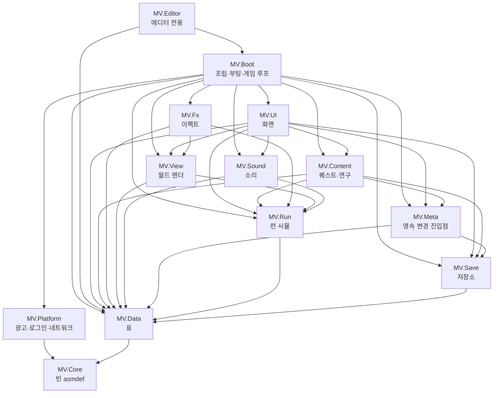

# MoonVillage 코드 구조 문서

**사람이 읽는 판: [MoonVillage_CodeStructure.pdf](MoonVillage_CodeStructure.pdf)** (다이어그램 17개·표 중심, 원본 `pdf_src/`).

이 폴더는 게임 코드가 **어디서 무엇을 하고, 무엇을 불러 어디로 넘기며, 리소스를 어떻게 잡고 재사용하는지** 설명한다. 이 파일은 전체 지도이고, 세부는 아래 다섯 문서에 있다.

기준 커밋은 `dev` 046c8be6(2026-11-15)이다. 모든 근거는 `파일:줄`로 달았고, 그 커밋의 코드를 직접 읽어 확인했다. 코드가 바뀌면 줄 번호가 밀릴 수 있다. 그때는 클래스·메서드 이름으로 찾는다.

| 문서 | 범위 | 이럴 때 읽는다 |
|---|---|---|
| [01_Boot_GameLoop.md](01_Boot_GameLoop.md) | MV.Boot, 씬 2개, MV.Editor(빌드·아트 입고·표 도구), link.xml | 앱 시작 순서, 로비↔런 순환, 프레임 루프, 빌드 |
| [02_Data_Tables.md](02_Data_Tables.md) | MV.Data, 표 72개, TSV→Resources 빌드, 검증, 드롭 | 표 추가·열 추가, 수치가 어디서 오는지, 드롭 계산 |
| [03_Logic_Run_Meta_Save.md](03_Logic_Run_Meta_Save.md) | MV.Run(시뮬), MV.Meta(메타 요청), MV.Content(퀘스트·연구), MV.Save | 전투·피해·틱 순서, 정산, 강화 요청, 저장 |
| [04_View_Fx_Sound_Resources.md](04_View_Fx_Sound_Resources.md) | MV.View, MV.Fx, MV.Sound, Addressables 전체 | 오브젝트 뷰·풀, 카메라·빌보드, 이펙트·소리, 에셋 수명 |
| [05_UI_Platform.md](05_UI_Platform.md) | MV.UI(로비·HUD·결과·메타 화면 8종·퀘스트·연구), MV.Platform | 화면 열기, Presenter·View 구조, 광고·로그인·네트워크 |

경로 약어: `S/` = `Assets/Game/Scripts/`.

---

## 1. 한 문장 요약

Boot 씬의 `GameBootstrap`이 Addressables·표·저장·메타·UI·소리를 차례로 준비하고 Game 씬을 연다. Game 씬에서는 `MvGameLoop` 하나가 **로비 → 런 → 지도 → 결과 → 로비**를 돌린다. 런은 순수 C# 시뮬 `RunSim`이 결정적으로 계산하고, 화면(View·Fx·Sound·HUD)은 그 상태와 이벤트를 **읽기만** 한다. 저장되는 모든 변경은 `MvMeta.Send` 한 곳을 지나 `MvSaveStore.ApplyAndSave`로 한 번에 쓰인다.

```
[Boot 씬] GameBootstrap.Start ─ 1~10단계 await ─▶ CustomSceneManager.LoadSceneAsync("Game")
                                                        │
[Game 씬] GameInitializer.OnInitializeAsync ─▶ AddComponent<MvGameLoop> ─▶ InitAsync ─▶ 로비
                                                                                        │
   ┌─────────────────────────────── MvGameLoop.Update ─────────────────────────────────┘
   │  Lobby : SyncLobbyTrack (Tick 없이 다음 런 미리보기 그림)
   │  Run   : 입력 → RunSim.Tick → DrainEvents → Sound/Fx/World → SyncObjects/SyncCats
   │  끝    : FinishRun → 지도 팝업 → 결과 팝업 → 「받기」 → MvMeta.Settle(저장 1회) → 로비
   └────────────────────────────────────────────────────────────────────────────────────
```

---

## 2. 어셈블리(모듈) 지도

`S/MV.*/MV.*.asmdef`의 `references`에서 읽은 의존이다. 화살표는 「참조한다(안다)」는 뜻이다.



| 모듈 | 파일·줄 수(시험 제외) | 하는 일 | 모르는 것(의존 경계) |
|---|---|---|---|
| MV.Boot | 8 / 1.3k | 부팅 10단계, `MvGameLoop`(Game 씬 순환), 저장→런 입력 변환, 입력 읽기 | (최상위. 아무도 Boot를 참조하지 않음, Editor만 예외) |
| MV.Data | 26 / 7.0k | 표 72개 로드·색인·검증, 드롭 추첨 | 다른 게임 모듈 전부 |
| MV.Run | 18 / 3.5k | 런 시뮬(상태·틱·생성·규칙·이벤트). Unity API 거의 없음 | Meta·Save·View·UI |
| MV.Meta | 10 / 1.9k | 메타 명령 → 로컬 백엔드 판정 → 원자 저장 | **Run·Content** |
| MV.Content | 3 / 0.6k | 퀘스트·연구. Meta 백엔드에 처리기를 등록 | View·UI |
| MV.Save | 13 / 2.0k | 저장 컨테이너 20종, 열기·이관·참조 정리·저장 | Run·Meta |
| MV.View | 41 / 6.3k | 월드·카메라·오브젝트 뷰·캐릭터·투사체·배경·풀 | Meta·Save·UI |
| MV.Fx | 14 / 2.5k | 런 이벤트 → `04_effect` → Framework EffectManager | Save·UI |
| MV.Sound | 8 / 0.7k | 런 이벤트·UI 신호 → `03_sound` → Framework AudioManager | View·UI |
| MV.UI | 56 / 6.3k | 로비 Screen, 런 HUD, 결과·지도·메타·퀘스트·연구 Popup | Boot |
| MV.Platform | 12 / 1.0k | 광고·로그인·네트워크 틀(대부분 아직 게임에 연결 안 됨) | 게임 모듈 전부 |
| MV.Editor | 14 / 2.7k | APK 빌드, 아트 입고·아틀라스·Addressables 정리, 표 도구 | (에디터 전용) |

경계 때문에 생기는 「번역」 지점 두 곳을 기억하면 흐름이 읽힌다.

- **저장 → 런 입력**: Run은 Save를 모른다. `MvRunSnapshot.FromStore` → `MvRunStart.CreateContext`가 Boot에서 바꾼다(`S/MV.Boot/MvRunStart.cs:38-61, 131-159`).
- **런 결과 → 정산 입력**: Meta는 Run을 모른다. `ResultViewData.Create`가 UI에서 `RunResult`를 `MvRunOutcome`으로 옮긴다(`S/MV.UI/Result/ResultContracts.cs:45-76`).
- **Meta ↔ Content**: Meta는 Content를 모른다. Content가 `MvLocalMetaBackend.RegisterContent/RegisterContributor`로 처리기를 꽂는다(`S/MV.Meta/MvLocalMetaBackend.cs:632-659`).

---

## 3. 연결 방식: 정적 등록소

DI 컨테이너는 없다. 모듈은 **정적 슬롯**에 인스턴스를 두고 서로 찾는다. 모든 슬롯은 `[RuntimeInitializeOnLoadMethod(SubsystemRegistration)] ResetStatics()`로 Play마다 비운다(Domain Reload를 꺼도 깨끗하게 시작).

| 슬롯 | 채우는 곳(시점) | 주로 읽는 곳 |
|---|---|---|
| `MvTables.Current` | `MvTableLoader.LoadAsync`(부팅 4단계) | 모든 모듈. Fx·Sound는 `() => MvTables.Current` 공급 함수로 매번 읽음 |
| `MvSave.Current` + 이벤트 `CurrentChanged` | `MvSave.Init/Retry/StartFresh/Reopen/Shutdown` | `MvBootSave.BindResources`, `MvBootMeta.OnSaveChanged`, 로비 화면, `MvGameLoop` |
| `MvBootSave.Resources`(재화 서비스) | `BindResources`(저장이 열릴 때마다 새로) | `MvMeta`(공급 함수) |
| `MvMeta.Current` | `MvBootMeta.OnSaveChanged`(저장이 처음 열릴 때 1번) | `MvGameLoop`, UI Port(`MvMetaUiPort` 등), 정산기 |
| `MvQuest.Current` | `MvQuest.Install`(MvMeta 생성 직후) | 결과 정산기(`RecordRun`), 퀘스트 화면 |
| `MvSound.Player` | `MvSound.InstallDefault`(부팅 9단계) | `MvGameLoop`, UI 컨트롤러 |
| `MvFx.Player` | `MvFx.InstallDefault`(`MvGameLoop.InstallFxAsync`) | `MvGameLoop.TickRun` |
| `GameBootstrap.Ui / State / ServicesReady` | `GameBootstrap.RunAsync` | `GameInitializer`, `MvGameLoop` |
| `MvGameLoop.Current` | `MvGameLoop.Awake` | 시험·개발 화면 |
| `ContentMenuData.OpenMetaHandler` | `MvBootMeta.Attach` | 컨텐츠 메뉴 「성장」 탭 |

모듈 사이의 C# 이벤트는 사실상 `MvSave.CurrentChanged` 하나다. 화면은 이벤트를 구독하지 않고 **매 프레임 값을 읽어 바뀐 것만 그린다**(로비 `LateUpdate`, HUD `LateUpdate`, 메타 패널은 누를 때와 1초 Tick). `MvMeta.Applied` 이벤트는 시험만 쓴다.

앱 수명 동안 남는 오브젝트(DontDestroyOnLoad): UI 부트스트랩(`UIManagerCreater`), `[MvSaveLifecycle]`, `MvSoundDriver`, `MvFxRunner`, Framework 싱글턴(AudioManager·EffectManager·CustomSceneManager·AddressablesManager). `MvGameLoop`와 그 아래 월드는 Game 씬 수명이다.

---

## 4. 핵심 흐름

각 흐름의 단계별 `파일:줄`은 링크한 절에 있다.

### 4.1 앱 시작 → 로비 ([01 §2.1](01_Boot_GameLoop.md))

`GameBootstrap.Start`(Awake가 아님, `S/MV.Boot/GameBootstrap.cs:56`) → `RunAsync`가 아래를 차례로 `await`한다. 한 단계라도 예외면 `State = Failed`로 멈추고 재시도하지 않는다.

| 단계 | 하는 일 | 호출 |
|---|---|---|
| 1·2 | Addressables 초기화, Framework `AddressablesManager.InitAsync` | `GameBootstrap.cs:78-86` |
| 3 | 소리·이펙트 공급자를 Addressables로 지정(첫 재생 전이어야 함) | `:89-90` |
| 4 | 표 로드·검증. 검증 오류면 부팅 중단 | `MvBootMeta.LoadTablesAsync` → `MvTableLoader.LoadAsync` |
| 5·6 | 저장 열기(실패해도 계속), 일시정지 저장 안전망 | `MvBootSave.Open` → `MvSave.Init`, `MvSaveLifecycle.Ensure` |
| 6 뒤 | `MvMeta`·`MvQuest` 생성 연결 | `MvBootMeta.Attach` |
| 7 | 다국어: **비어 있음**(문구 키 그대로) | `:105` 주석 |
| 8 | UI 매니저 생성 | `MvUiBoot.InitAsync` → `UIManagerCreater.StartInitAsync`(주소 `UIManager`) |
| 9 | 소리 설치, 로컬 네트워크(`net.ping`만), `ServicesReady = true` | `:112-117` |
| 10 | Game 씬 전환. Framework가 `GameInitializer.OnInitializeAsync`를 await | `CustomSceneManager.LoadSceneAsync("Game", Direct)` |

Game 씬: `GameInitializer`가 `MvGameLoop`를 `AddComponent`로 붙이고 `InitAsync`를 await한다. `InitAsync`는 UI 재연결 → 입력기 생성 → `WorldRoot` 프리팹 생성(lease) → 지역 테마·스테이지 맵 → 이펙트 머티리얼·`MvFx` 설치 → 씬 카메라 대신 월드 카메라 사용 → `EnterLobbyAsync` 순서다. 그래서 `GameBootstrap.State == Succeeded`는 **로비가 열린 뒤**에 된다. 에디터에서 Game 씬을 바로 Play하면 `GameInitializer`가 Boot 씬부터 다시 연다(대체 경로로 데이터를 만들지 않는다).

### 4.2 런 시작 ([01 §2.3](01_Boot_GameLoop.md), [03 §2.1](03_Logic_Run_Meta_Save.md))

로비 「출발」(또는 Space/Enter) → `MvGameLoop.OnLobbyStart` → `StartRun`:

1. 런 순번: `MvMeta.BeginRun()`(저장이 없으면 `PeekRunSeq`).
2. 저장 → `MvRunSnapshot` → 시드 `SeedFor(runSeq)`(SplitMix64) → `MvRunStart.CreateContext`(표 `13_areaUpgrade`·`14_rebirthPerk`의 statKey로 성장치 반영) → 연구 보정 `MvResearch.Modifiers`.
3. `RunSim.Create(ctx, MainRunRule, Pcg32Rng(seed), RunLevelBuilder)` → `RunLevelBuilder.BuildLevel`이 이번 런의 오브젝트를 **전부 미리** 만든다(런 중 동적 스폰 없음).
4. `LoopViewSource.Run`만 바꿔 카메라가 로비 자세에서 런 자세로 이어서 움직인다. `WorldView.RebuildProps`, `Phase = Run`.
5. `MvUiNav.EnterRunAsync` → 로비 Screen 숨김, 런 HUD(풀에서) 켜고 `RunHud.Bind(RunStateHudSource)`.

같은 저장·같은 순번이면 같은 런이 나온다. 로비 화면 뒤에 보이는 트랙도 **다음 순번의 sim을 Tick 없이** 만들어 그린 것이다.

### 4.3 프레임 루프 ([01 §2.4](01_Boot_GameLoop.md), [04 §2](04_View_Fx_Sound_Resources.md))

`MvGameLoop.Update` → `TickRun`(`S/MV.Boot/MvGameLoop.cs:371-403`):

```
입력  MvRunInputReader.Read(state)        // 드래그 목표 x, 키보드 축. 결과 단계면 None
시뮬  RunSim.Tick(unscaledDt, input) × TicksPerFrame   // Result가 되면 멈춤
이벤트 events = RunSim.DrainEvents()       // 프레임당 딱 1번 비움
      MvSound.OnRunEvents(events)  → 03_sound → AudioManager
      MvFx.OnRunEvents(events)     → 04_effect → EffectManager
      WorldView.OnRunEvents(events) → 피격 흔들림·우물 벽돌
      ClimbStart 이벤트면 WorldView.RebuildProps(계단 위 새 지형)
상태  WorldView.SyncObjects(state.Objs) / SyncCats(state)   // 뷰를 상태에 맞춤
끝    state.Phase == Result → FinishRun()
```

그 뒤 `LateUpdate` 순서(`DefaultExecutionOrder`): `CameraRig`(−100) → `GroundStripMesh`(50) → `PropStreamer`·`StageMap`(60) → `DepthSorter`(100: 빌보드 회전 일괄·깊이 정렬) → `TintLayer`(110) → `ScreenRig`(120). HUD는 이벤트 대신 `RunState`를 `LateUpdate`에서 직접 읽는다. 이펙트·지연 소리의 시간 진행은 각자의 DDOL 드라이버(`MvFxRunner`, `MvSoundDriver`)가 `Update`에서 한다.

**시뮬 한 틱**(`RunSim.Rules.cs:29-150`, [03 §2.3](03_Logic_Run_Meta_Save.md)): 실시간 타이머 → 히트스톱 → `UpdRun` 16단계(전진·골목 통과·계단 진입·벽 막힘·게이트·공방 지급·쥐 추적·사격·투사체 명중·빛/유성·폭풍·화상·위성·`Rule.CheckEnd`) 또는 `UpdClimb` → 룰렛 → `StepFx` → `SyncWells`. 규칙 난수는 `RunState.Draw(RngUse)`로만 뽑고, 확률이 0이면 뽑지 않는다. 피해는 정수로 버림하고 `[DMG_MIN, DMG_MAX]`로 자른다.

### 4.4 런 종료 → 정산 → 로비 ([01 §2.5](01_Boot_GameLoop.md), [03 §4.2](03_Logic_Run_Meta_Save.md), [05 §5.4](05_UI_Platform.md))

1. `FinishRun`: `Phase = Result`. `ResultViewData.Create`가 `RunResult`를 화면용 값과 `MvRunOutcome`으로 바꾼다.
2. 지도 팝업 → 닫히면(`OnClosed`) 결과 팝업. 결과 뒤에서도 `TickRun`은 입력 없이 계속 돌아 월드 연출이 이어진다.
3. 「받기」 → `CountingSettler` → `MvMetaResultSettler` → `MvMeta.Settle` → 백엔드가 **클라이언트 값을 믿지 않고 저장값으로 다시 판정** → `ApplyAndSave` 1번. 런 결과 저장은 여기서 한 번뿐이다.
4. 정산이 성공하면 `MvQuest.RecordRun`이 계단·벽 퀘스트 카운터를 따로 저장한다.
5. `OnCollected` → `EnterLobbyAsync` → 다음 순번 로비 트랙.

### 4.5 메타 요청(강화·환생·신 선택·광고·퀘스트·연구) ([03 §4.1](03_Logic_Run_Meta_Save.md), [05 §5.5](05_UI_Platform.md))

```
버튼 → Presenter → Port(IMetaUiPort 등) → MvMeta.BuyAreaUp() 같은 명령
     → MvMeta.Send(MvMetaRequest{Name, Params})              S/MV.Meta/MvMeta.cs:67-94
        → MvLocalMetaBackend.Handle    // 판정만. 상태를 바꾸지 않고 새 값(Data)만 계산
           → 등록된 contributor(퀘스트 등)가 같은 응답에 값을 보탬
        → 거절이면 MvMetaErrors 코드 반환(저장 안 함)
        → MvSaveStore.ApplyAndSave(Data, keys)   // 원자 저장 1번(하나라도 실패하면 아무것도 안 바뀜)
        → Applied 이벤트
     → Presenter.Draw()로 다시 그림
```

- 요청 이름은 서버 함수 이름과 같게 둔다(`meta.settle`, `meta.buyAreaUp`, `meta.rebirth`, `meta.selectGod`, `meta.grantAd`, `meta.questClaim`, `meta.startResearch` …, `S/MV.Meta/MvMetaRequest.cs:36-80`).
- 시험 `MvMetaEntryPointRuleTests`가 MV.Meta·MV.Save 밖에서 `ApplyAndSave(`·`.Commit(`을 쓰면 실패시킨다. **영속 변경은 Meta/Save에서만** 한다는 규칙을 시험이 강제한다.
- 주의: 프로젝트 설정은 서버 판정 기능을 `NetworkManager` + `NetworkRequest` 하위 클래스로 보내라고 정했지만, 지금 `MvMetaRequest`는 `NetworkRequest`와 **모양만 같은 별도 클래스**다. `NetworkManager`에 등록된 요청은 점검용 `net.ping` 하나다. 서버 전환 때 이 부분을 바꾼다([03 §3.5](03_Logic_Run_Meta_Save.md)).

### 4.6 저장 ([03 §4.6](03_Logic_Run_Meta_Save.md))

- **열기**: `MvSaveStore.Open` = 키 공급·암호화 코덱 → `LocalSaveRepository.Load`(PlayerPrefs 두 칸, 한 칸 손상이면 백업 복구) → 스키마 이관(v0 프로토 → v1) → 컨테이너 20종 등록·채움 → 표 기준 참조 정리(없는 신·덱 길이·상한) → `CurrentChanged`.
- **쓰기**: 사건마다 `MvMeta.Send` → `ApplyAndSave`. 쓰기 실패면 `RequiresReopen`이 되어 `MvMeta.IsReady = false`.
- **안전망**: 앱 일시정지·종료 → `MvSaveLifecycle` → `MvSave.OnApplicationPause(true)` → `SaveIfDirty`.
- 재화는 Framework `WealthContainer` + `ResourceService`(저장이 다시 열릴 때마다 새로 묶음)가 다룬다.

### 4.7 화면 열기 ([05 §1·§2](05_UI_Platform.md))

모든 화면 열기는 정적 `MvUiNav` 한 곳을 지난다. 화면 ID(`MvUiIds`) 앞에 접두어를 붙인 것이 Addressables 주소다: `UIScreen_Lobby`, `UIHud_Run`, `UIPopup_Result` 등. 화면 하나는 3층이다: Framework 컨트롤러(열기·닫기·소리) → 순수 C# Presenter(표·Port에서 모델을 만들고 명령을 부름) → View(`IXxxView`, 받은 값만 그림). 메타 화면 8종은 `MetaPanelPopup/Presenter/View` 공통 틀 하나를 쓰고, 새 메타 화면은 Popup·Presenter 하위 클래스와 프리팹 하나씩만 더하면 된다. 지금 View는 대부분 프리팹이 비어 있고 `EnsureBuilt`가 실행 중 코드로 자식을 만든다(임시 겉).

---

## 5. 리소스 관리와 재사용

### 5.1 데이터 원본 세 가지

| 종류 | 원본 → 런타임 | 규칙 |
|---|---|---|
| 표 | 시트 → `GameData/Table/TSV/NNN_name.txt`(정본) → Framework TableBuilder(+ 게임 검증기) → `GameData/Table/Resources/NNN_name.txt` → 부팅 때 `Resources.Load` | 런타임은 **Resources 산출물만** 읽는다. 에디터에서도 TSV로 우회하지 않는다. TSV만 고치고 빌드를 안 돌리면 옛 값이 나온다 |
| 그림·프리팹·소리 | `Assets/Game/Addressables/Local/<Category>/…` → 그룹 `Local_<Category>` | 주소 = 파일 이름(확장자 제외), 하위 폴더는 정리용. 원격은 언어팩만(아직 없음) |
| 저장 | PlayerPrefs 두 칸(암호화) ↔ `MvSaveStore` 컨테이너 | 쓰기는 Meta/Save에서만 |

표는 부팅 때 한 번 읽어 `MvTables.Current` 하나에 두고 앱 내내 쓴다. 로드할 때 id·key·group·정렬 사전을 한 번 만들고, 행은 `private set`이라 사실상 읽기 전용이다([02 §7](02_Data_Tables.md)). 열을 하나 더하려면 행 클래스 `Init`, `Schema`, TSV 세 곳을 같이 고친다([02 §9](02_Data_Tables.md)).

Addressables 그룹 항목·라벨·아틀라스는 손으로 맞추지 않는다. `MvArtSetup.EnsureAll`(메뉴 `MV/Art/Ensure Import·Atlas·Addressables`, 아트 폴더가 바뀌면 자동 요청)이 폴더 규칙으로 멱등하게 맞춘다([01 §5.2](01_Boot_GameLoop.md)).

### 5.2 Addressables 로드 경로 두 갈래 ([04 §6](04_View_Fx_Sound_Resources.md))

1. **게임 코드**: 항상 Framework `AddressableScope.Get<T> / GetPrefab / InstantiateWithLease`를 쓴다. `AddressablesManager`가 키마다 핸들 1개와 참조 수를 가진다. lease를 `Dispose`하면 참조가 1 줄고, 0이 되면 바로 `Addressables.Release`한다. `InstantiateWithLease`의 lease는 인스턴스가 실제로 파괴된 뒤에 풀린다.
2. **Framework 매니저 자체 공급자**: 이펙트(`AddressablesEffectPrefabProvider`)와 소리(`AddressablesClipProvider`)는 `Addressables.LoadAssetAsync`를 직접 부르고 참조 수와 풀을 따로 가진다.

로드 실패는 재시도하지 않는다. 오류 로그를 한 번 남기고 그 대상만 그리지 않는다. 대체 그림이나 대체 경로로 가리지 않는다. 비동기 로드가 끝났을 때 요청한 쪽이 이미 파괴됐으면 받은 lease를 바로 반환한다.

### 5.3 에셋 수명

| 수명 | 에셋 | 잡는 곳 → 놓는 곳 |
|---|---|---|
| 앱 전체 | `UIManager`, 쓰는 중인 이펙트 프리팹, 재생 중인 소리 | Framework 매니저 → 풀 컬링·재생 끝 |
| Game 씬 | `WorldRoot` 인스턴스, 이펙트 머티리얼 `MV_FxNormal`·`MV_FxAdd` | `MvGameLoop._leases` → `MvGameLoop.OnDestroy` |
| WorldView | 오브젝트 프리팹(`105`/`305`.prefab), 캐릭터 프리팹, 투사체 그림, 계단 칸 프리팹, 아틀라스 | 각 컴포넌트 → 각 `OnDestroy` |
| 지역(area) | 스테이지 맵 프리팹(`302_area.stageMap`) | `MvGameLoop._stageLeases` → 다음 지역을 로드하기 직전 |
| 테마 | 테마 월드 아틀라스(`304_theme.worldAtlas`) | `WorldView.SetThemeAsync` → 새 아틀라스를 먼저 로드한 뒤 옛것 반환 |
| 캐릭터 묶음 | `116_charLook.atlas` | `CharacterPresenter` → 묶음당 LRU 3개를 넘으면 반환 |

같은 지역·같은 테마면 다시 로드하지 않는다. 런과 런 사이(런 → 결과 → 로비 → 새 런)에는 월드 에셋을 놓지 않는다. 뷰 GameObject는 풀로만 돌아간다.

### 5.4 오브젝트 재사용(풀) ([04 §7.3](04_View_Fx_Sound_Resources.md))

시뮬 안에는 풀이 없다. 오브젝트 id는 런 안에서 `NextObjId++`로 계속 늘고, 죽은 오브젝트는 `Dead` 표시만 한다. 실제 제거는 계단을 오를 때 `ShiftWorld`가 뒤쪽을 지울 때와 투사체 정리 때뿐이다. 재사용은 모두 뷰 쪽에서 한다.

| 풀 | 키 | 대여 / 반납 | 초기화 |
|---|---|---|---|
| `ObjectViewFactory` | `_views: objId → View`. 풀은 프리팹 주소별 `_prefabPool`과 코드 모양별 `_pool` | 그리기 범위 안에 들어오면 `Show`, 이번 프레임에 안 보이면 `Release`(쓰러지는 연출 중이면 끝날 때까지 남김) | **꺼낼 때와 돌려줄 때 둘 다** `ResetMotion`(흔들림·눌림·쓰러짐·구슬). id는 런마다 1부터 다시 쓰이므로 같은 id라도 `v.Obj != o`면 돌려주고 새로 꺼낸다(MV-VIEW-OBJRESET, `ObjectViewFactory.cs:404-405`) |
| `ProjectileView` | 투사체 id → Item, free Stack | 상한 64(`MaxProjs`, 표에 없는 [창작] 값) | 다시 빌린 첫 프레임에 `ResetTrails` |
| `CharacterPresenter`/`CharacterPool` | 자리(unit index) 고정 + 주소별 `ObjectPool<CharacterRig>` | 행의 prefab 주소가 바뀌면 반납 후 새로 Get | 반납 때 `rig.Clear()` |
| `PropStreamer` | `PropKind`별 Stack | 그리기 범위를 드나들 때 | — |
| `ClimbStairView` | 리스트 앞에서부터 `_used`개 | 나머지 비활성 | — |
| Framework `EffectPool` | 이펙트 타입별 idle Stack | 기본 프로필 minRetain 1 / maxPool 32 / idle 15초(Boot 씬 값) | 타입 인스턴스가 모두 컬링되면 프리팹 lease 반환 |
| Framework `AudioManager` | 소스 풀 16(확장 가능) | 재생마다 | — |
| UI Screen·HUD | Framework `screenPool`·`hudPool` | 로비 Screen·런 HUD는 계속 재사용 | — |
| UI Popup | 없음 | 열 때마다 생성, 닫으면 파괴 | — |
| 메타 패널 행 | 없음 | `MetaPanelView.Render`마다 전부 Destroy 후 다시 생성 | — |

빌보드(2.5D 정면 보기)는 프리팹이 「빈 부모 하나」에 `Billboard`를 붙여 정한다. 코드는 붙이지 않고, 없으면 오류만 낸다. 회전은 `DepthSorter`가 `Billboard.SyncAll`로 한 번에 적용한다(MV-VIEW-BILLBOARD2). 캐릭터는 Spine·Animator 없이 SpriteAtlas 그림 교체와 코드로 계산한 흔들림(`CharStateMachine`)으로 움직인다.

---

## 6. 무엇을 고치려면 어디를 보나

| 하고 싶은 것 | 시작점 |
|---|---|
| 수치 바꾸기 | `Assets/Game/GameData/Table/TSV/NNN_*.txt` 고치기 → TableBuilder 실행. 코드에 숫자를 박지 않는다(AGENTS.md) |
| 표·열 추가 | `S/MV.Data/Tables/Band*Tables.cs`(행 `Init`·`Schema`), `MvTables.RegisterAll`, 검증 `MvTableValidator*.cs`([02 §2·§9](02_Data_Tables.md)) |
| 런 규칙·전투 | `S/MV.Run/Sim/RunSim.Rules.cs`(`TickCore`·`UpdRun`·`Hit`), 공식 `RunFormulas`, 300 표 설정 키 `RunConfigKeys`([03 §1·§2](03_Logic_Run_Meta_Save.md)) |
| 코스(레벨) 생성 | `S/MV.Run/Gen/RunLevelBuilder.cs`, `LevelGen`, `FieldGen` |
| 새 오브젝트 종류 | `105_objectKind` 행 + 컴포넌트(106~109·114). 동작은 이름이 아니라 표 플래그·컴포넌트 type으로 정해진다. 그림은 `105.prefab` → `Addressables/Local/BG` |
| 오브젝트 그림·풀 | `S/MV.View/Runtime/ObjectViewFactory.cs`(`Sync`·`Show`·`Release`·`ResetMotion`) |
| 카메라 | `S/MV.View/Runtime/CameraRig.cs`, 공급원 `RunStateViewSource`·`MvGameLoop.LoopViewSource` |
| 이펙트 추가 | `04_effect` 행(그룹·prefab) + `Addressables/Local/Effect` 프리팹. 이벤트 → 그룹 대응은 `MvFxRouter` |
| 소리 추가 | `03_sound` 행 + `Addressables/Local/Audio/Sfx`. 이벤트 → 소리는 `MvRunSoundRouter`, UI 소리는 `MvUiSounds` |
| 새 메타 화면 | `MetaPanelPopup`·`MetaPanelPresenter` 하위 클래스 + `UIPopup_<Id>` 프리팹 + `MvUiIds`·`MvUiNav`([05 §3.5-3.6](05_UI_Platform.md)) |
| 새 메타 명령 | `MvMetaRequestNames` 이름 + `MvLocalMetaBackend` 처리기 + `MvMeta` 명령 메서드. 상태는 처리기에서 바꾸지 않고 `Data`로 돌려준다 |
| 저장 항목 추가 | `S/MV.Save/MvSaveContainers.cs`(컨테이너), `MvSaveKeys`, `MvSaveDefaults`, `MvSaveNormalize` |
| 부팅 단계 | `S/MV.Boot/GameBootstrap.cs` `RunAsync` |
| 빌드 | `S/MV.Editor/Build/MvBuild.cs` `BuildAndroidDev`(표 빌드 → Addressables → APK) |

---

## 7. 아직 비어 있거나 연결되지 않은 곳

새로 개발할 때 「있는 줄 알았는데 없는」 곳들이다. 세부와 근거는 각 문서의 마지막 절(01 §8, 02 §9, 03 §5.2, 04 §8, 05 §7)에 있다.

- **다국어 없음**: 부팅 7단계가 비어 있고 `UIRuntimeOptions.Localize`가 키를 그대로 돌려준다. 언어팩 데이터·로더도 없어 코드 안 한국어 기본 문구가 그대로 나온다.
- **NetworkRequest 미적용**: 메타 요청은 `NetworkManager`를 거치지 않는다(§4.5).
- **광고·로그인 미연결**(D-90): `MvAds`·`MvLogin`은 틀만 있다. 실제 광고는 `MvFakeAdService`와 가짜 광고 팝업, 로그인은 로컬 게스트 스텁이다.
- **UI 연결 지점이 빈 것**:
  - `MvUiToast.Handler`가 없어 토스트는 로그로만 나간다.
  - `ContentMenuData.StartModeHandler`가 없어 모드 카드는 「준비 중」만 띄운다.
  - `MvDebugHooks`가 없다.
  - `OpenFeatureUnlockAsync`를 부르는 곳이 없다.
  - `LobbyViewData.OnFacilityBump`를 넘기지 않는다.
  - Esc로 팝업을 닫으면 `OnClosed`가 불리지 않는다.
- **배지**: `com.jjevol.badge`를 쓰지 않는다. 빨간 점은 퀘스트의 `●` 문자열뿐이다.
- **Fx 그림 쪽 미구현**: 팝업·비행·플래시 View 구현이 없어 화면에 나오지 않는다. `MvFx.InstallDefault`의 머티리얼 인자도 쓰이지 않는다.
- **안 쓰는 코드**: `LobbyStage`, `MvWarpOverlay`, `MvSaveTriggers`.
- **저장 열기 실패 안내**: `MvBootSave.PendingNotice`를 UI가 읽지 않는다.
- **표만 있고 쓰지 않는 것**: 천장(803/804), 상자 열기, 상점 7xx, 모드 401/402, 메타 표 다수는 검증만 한다.
- **메모리**: `ObjectViewFactory._prefabs`는 맵이 바뀌어도 이전 맵 전용 프리팹 lease를 놓지 않는다(WorldView가 파괴될 때까지 남음).

---

## 8. 이 문서를 고칠 때

- 구조가 바뀌는 계약(모듈 경계·부팅 단계·풀·리소스 수명·요청 경로)을 병합하면 해당 문서 절과 이 파일의 표를 같이 고친다.
- 근거는 `파일:줄`로 단다. 확인하지 않은 것은 「확인 안 함」으로 적는다.
- 기획 규칙 자체는 여기에 옮기지 않는다. 기획서(`Docs/MV-SPEC-01`, `Docs/MV-SPEC-02`)를 가리킨다.
